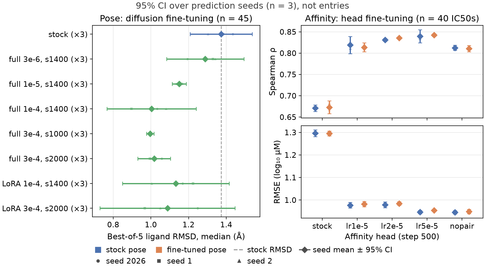
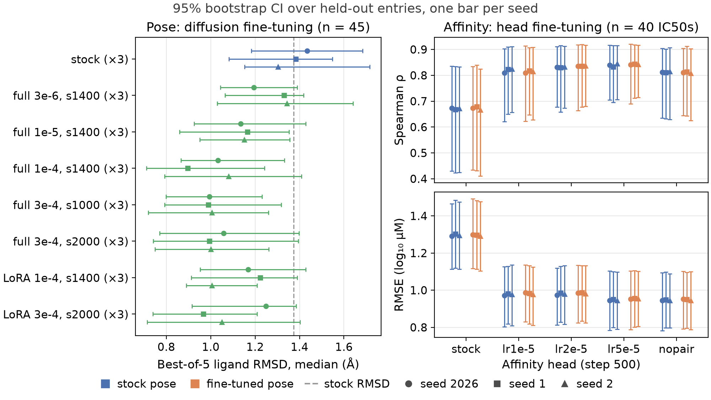

# Boltz-2 fine-tuning on Mac1: report

Status as of 2026-10-15. Built from the running logs in this directory; each section links to the detailed source. Numbers are from the result files under `experiments/results/` (on `/eagle`, linked from the repo).

## Results at a glance

Both figures show the same numbers with different error bars. Left: diffusion fine-tuning, median best-of-5 pocket-aligned ligand RMSD on the 45 held-out entries (lower is better). Right: affinity-head fine-tuning (step 500), Spearman (top) and RMSE in log10 uM (bottom) on the 40 measured IC50s, with each head scored on stock poses (blue) and on poses from the `full_lr1e-4` step 1400 structure fine-tune (orange). Run labels give the number of prediction seeds; every run is at seeds 2026, 1 and 2 (seeds 1 and 2 of full 3e-6 s1400 and full 3e-4 s1000/s2000 were added 2026-10-16, PBS 7755583/5/6). Swarm (agent) results are summarized separately in `docs/rescore/batch2_report.md` and `figures/swarm_summary_bootstrap.png`.

**Val and test are pooled** for both pose and affinity. They are built the same way (ligand clusters shuffled into val and test), and checkpoints and runs were chosen on all 45 entries, so neither is an untouched test set; one pooled estimate is less noisy than two on 18 and 22 IC50s. A clean test number would need selection on val only, then a single test evaluation (next steps, item 1).

**Held-out set.** The 45 entries are all Mac1 crystal structures with an IC50 and a deposited ligand pose in the val (21) or test (24) split. None is used in any training. They cover 15 ligand clusters (8 val, 7 test) that the split keeps apart from training clusters, and were released 2025-05 to 2026-09, after the Boltz-2 training cutoff. Sources: Correy et al. *Sci. Adv.* 2025 (24), Jaishankar et al. *J. Med. Chem.* 2025 (18), Suryawanshi et al. *eLife* 2025 (2), Xu et al. *Nature* 2026 (1). Resolution 0.80-1.11 A; IC50 0.02-1000 uM. The pose metric uses all 45 (5 samples each, the median over entries per run). Affinity uses the 40 measured (`=`) IC50s (18 val, 22 test); the 5 censored ones are scored separately. Deposited ligand occupancy is low (median 0.34), so the reference poses are only weakly supported by density.

### Error bars over prediction seeds

Diamonds are the mean over prediction seeds 2026, 1 and 2; bars are a 95% t-interval over those seeds (n = 3, mean +/- 4.30 x SD / sqrt 3); the small dots are the individual seeds. **This interval is over seeds, not over entries**: it shows how reproducible a number is when only the diffusion sampling seed changes, with the same 45 entries. Affinity bars are very narrow because seeds move affinity predictions by a median of 0.02-0.04 log10 per entry. Some heads give identical Spearman at all three seeds (no bar), because small changes in the predictions did not change the rank order.

### Error bars over entries (bootstrap)

One marker per prediction seed, each with a 95% bootstrap interval over held-out entries (2000 resamples of the entries, statistic recomputed each time). **This interval is over entries, not seeds**: it shows how much a number could move with a different small set of compounds, the dominant uncertainty here.

Reading both together: seed noise is small, entry-set noise is large. Every run and head is scored on the same entries, so differences between them are better judged by the paired comparisons in section 5. For example, a tuned head minus the stock head on identical entries gives Spearman +0.14 to +0.17, with every 95% interval above zero. Step 500 and the runs shown were chosen on these same entries, so the tuned values are optimistic.

Regenerate with `python experiments/plot_results_glance.py` (needs matplotlib, which is not in the Boltz environment). It also writes the plotted values to `docs/figures/results_at_a_glance_pose.csv` and `results_at_a_glance_affinity.csv`.

## 1. Summary

- **Structure (diffusion) fine-tuning works mechanically but barely changes the pose.** On 45 held-out Mac1 complexes, top-1 ligand RMSD improves by 0.02-0.10 A per entry against the stock model at the same prediction seed; most 95% intervals touch zero, and prediction-seed noise on the median (0.2-0.3 A) is larger than any difference between runs. Best-of-5 RMSD improves more (about 1.4 to 0.9-1.2 A), so the tuned model samples better poses that the confidence score does not rank first.
- **The two candidate structure fine-tunes pass the regression check** on three non-Mac1 complexes (CA RMSD +0.01 to +0.09 A, ligand RMSD unchanged or slightly better, every sample within 2 A).
- **Affinity-head fine-tuning gives a clear gain.** Spearman on the 40 measured held-out IC50s rises from 0.68 to 0.81-0.84, RMSE falls from 1.31 to 0.95-0.99 log10, bias from +0.99 to about +0.6. Paired intervals exclude zero.
- **The affinity gain comes from the head, not the pose.** Replacing stock poses with fine-tuned poses under the stock head changes nothing (dSpearman -0.004 [-0.04, +0.02]). Per-entry affinity error is not correlated with pose RMSD.
- **Main caveat:** the 45 held-out entries were also used to choose checkpoints and runs. No result here is an untouched test number.

## 2. Data

Details: [`datasets.md`](datasets.md), [`data_schema.md`](data_schema.md).

- **Affinity labels:** 182 usable (public PDB entry, HTRF IC50) pairs from five Mac1 papers (eLife 2025, Sci. Adv. 2025 and 2021, PNAS 2023, J. Med. Chem. 2026), 0.02-1000 uM, some censored (`>`, a lower bound). Deduplicated to 171 PDB entries.
- **Split** (`src/boltz2_finetuning/splits.py`, seed 0): Butina clusters on Morgan fingerprints (Tanimoto >= 0.5) are never split, and any cluster with a structure released before the Boltz-2 cutoff (2023-06-01) is train-only. Result: train 125, val 21, test 25. Val/test are later analogues of the same target, so they measure within-series generalisation, not new proteins.
- **Training records** (`data/processed/mac1_training_records.csv`): 603 crystal entries, of which 557 train the diffusion head (`diffusion_train`); 2346 non-hit ligands (SMILES paired with the apo 7KQO structure, no pose) and 174 fragment hits as binary labels for the affinity head.
- **Held-out evaluation set:** 45 entries (21 val + 24 test) with an IC50 and a deposited pose, excluded from all training. 40 measured, 5 censored.
- **Ligand matching** (`src/boltz2_finetuning/ligands.py`): table SMILES are checked against the component actually deposited in each mmCIF; pose scoring uses the deposited SMILES. 96 pairs use 5-character CCD codes missing from Boltz's cache, rebuilt in Boltz's format by `src/boltz2_finetuning/ccd.py`.

### Structure sources

All 603 structures are public RCSB X-ray entries (`data/structures/mac1/`), found by scanning the paper supplements in `data/raw/mac1/` for PDB IDs and keeping entries with at least a 100-residue exact match to the Mac1 sequence of 5SQW (`experiments/fetch_mac1_structures.py`). Each structure is counted under the paper given as the primary citation of its PDB entry; the 62 entries whose citation is still "To be published" are assigned to the earliest paper whose supplement lists them. Publication dates are from Crossref (online date where available). Per-structure assignments: `data/processed/mac1_structure_sources.csv`.

| Published | Paper | DOI | Structures | Assigned via supplement | Diffusion train | Affinity train | Val | Test |
|---|---|---|--:|--:|--:|--:|--:|--:|
| 2020-07-17 | Michalska et al., *IUCrJ* | 10.1107/S2052252520009653 | 1 | 0 | 1 | 0 | 0 | 0 |
| 2020-11-18 | Rack et al., *Open Biol.* | 10.1098/rsob.200237 | 2 | 0 | 2 | 0 | 0 | 0 |
| 2021-03-16 | Ni et al., *ACS Med. Chem. Lett.* | 10.1021/acsmedchemlett.0c00684 | 4 | 0 | 4 | 0 | 0 | 0 |
| 2021-04-16 | Schuller et al., *Sci. Adv.* (fragment screen) | 10.1126/sciadv.abf8711 | 234 | 0 | 234 | 184 | 0 | 0 |
| 2021-08-01 | Brosey et al., *Prog. Biophys. Mol. Biol.* | 10.1016/j.pbiomolbio.2021.02.002 | 1 | 0 | 1 | 0 | 0 | 0 |
| 2022-05-27 | Correy et al., *Sci. Adv.* | 10.1126/sciadv.abo5083 | 1 | 0 | 1 | 0 | 0 | 0 |
| 2022-08-01 | Tsika et al., *J. Mol. Biol.* | 10.1016/j.jmb.2022.167720 | 1 | 0 | 1 | 0 | 0 | 0 |
| 2023-01-04 | Gahbauer et al., *PNAS* | 10.1073/pnas.2212931120 | 154 | 1 | 154 | 70 | 0 | 0 |
| 2023-02-15 | Schuller et al., *Pathogens* | 10.3390/pathogens12020324 | 1 | 0 | 1 | 0 | 0 | 0 |
| 2023-05-01 | Anmangandla et al., *ACS Chem. Biol.* | 10.1021/acschembio.3c00092 | 1 | 0 | 1 | 0 | 0 | 0 |
| 2025-05-30 | Correy et al., *Sci. Adv.* | 10.1126/sciadv.ads7187 | 137 | 0 | 112 | 36 | 13 | 12 |
| 2025-11-19 | Suryawanshi et al., *eLife* | 10.7554/eLife.103484 | 10 | 10 | 8 | 6 | 0 | 2 |
| 2025-12-17 | Jaishankar et al., *J. Med. Chem.* | 10.1021/acs.jmedchem.5c02933 | 18 | 17 | 0 | 0 | 7 | 11 |
| 2026-09-16 | Xu et al., *Nature* | 10.1038/s41586-026-11013-5 | 4 | 0 | 3 | 2 | 1 | 0 |
| 2026-10-12 | Kim et al., *eLife* | 10.7554/eLife.110475 | 34 | 34 | 34 | 1 | 0 | 0 |
| | **Total** | | **603** | **62** | **557** | **299** | **21** | **25** |

- Diffusion train + val + test = structures: diffusion training uses every structure except val/test.
- Affinity train counts structures whose predicted pose is an affinity-head training row: 124 IC50 pairs, 174 fragment hits and the apo structure 7KQO, which all 2,347 non-binder ligands share. All 299 are also in diffusion training.
- Val/test is 46 structures (an earlier split, before the 8 Schuller 2021 IC50s were added, had 48). 7HFX is a test structure but is not scored, because its deposited ligand does not match the table compound, so the held-out evaluation set is 45.
- Kim et al. *eLife* Supp. file 6 lists 420 of these structures, but most were first published by Schuller 2021, Gahbauer 2023 or Correy 2025, so it is credited with 34. The 17 J. Med. Chem. entries without a PDB citation are assigned through the paper's text and all sit in val/test.

## 3. Making it run on Polaris

Details: [`boltz2_polaris_log.md`](boltz2_polaris_log.md), [`diffusion_finetuning_progress.md`](diffusion_finetuning_progress.md).

**Environment and inference**
- `uv sync` from the locked `pyproject.toml` into `~/venvs/boltz2` (cu128 PyTorch, cuEquivariance cu12 kernels). The installed Boltz 2.2.1 is never modified; all changes live in this repo.
- `jobs/polaris/run_job.pbs` loads `cray-python/3.12.12` and `cuda/12.9`, activates the venv and runs a `JOB_SCRIPT`. Submit with `TMPDIR=/tmp qsub ...` (PBS staging failed on a read-only `/var/tmp`).
- Compute nodes have no outbound network: checkpoints and `mols.tar` are staged into `~/.cache/boltz` from a login node.
- `export CC=gcc` in the wrapper: Polaris sets `CC` to NVIDIA's `nvc`, and Triton's JIT build passes it a gcc-only flag (`-Wno-psabi`).
- `testing/boltz2_kernel_check.py` confirms that cuEquivariance kernels run on A100 (the "falling back" warning seen in smoke tests concerns sequences under 100 tokens and the Blackwell kernel).
- Multi-GPU prediction: `boltz predict --devices 4` is data parallel through Lightning DDP; no extra launcher needed on one node.
- Storage: the home quota filled during evaluations, so results and caches moved to `/eagle/GenesisHackathonOct26/hkwang/boltz2-finetuning`, with `experiments/results` a symlink.

**Training the diffusion head: what Boltz-2.2.1 does not do out of the box**

Boltz-2.2.1 ships no working fine-tuning path for this setup (the stock `trainingv2.py` data module uses the Boltz-1 featurizer; the `Boltz2_affinity` fork's `trainingv3.py` expects files we do not have). Each fix below came from a failed job:

1. Checkpoint arguments the installed code rejects or lacks: drop `mse_rotational_alignment`; add `pairformer_args.v2 = True`; full `steering_args` dict; `training_args` as an OmegaConf `DictConfig`; set `structure_prediction_training=True` (stored `False`, which disables the diffusion loss); drop `add_bond_loss`; set `model.validate_structure` after loading.
2. `Boltz2.forward` builds the diffusion conditioning only when `confidence_prediction` is on, and the stock `training_step` then asserts a batch size of 1 on coordinates that `forward` has already expanded to `diffusion_multiplicity` copies. `Boltz2Diffusion` (`src/boltz2_finetuning/model.py`) keeps `forward` and computes only the diffusion and distogram losses. It has no try/except, so a bad batch fails instead of being silently skipped (the stock step returns `None` on error).
3. A `Record` dataclass in the batch breaks Lightning's device transfer; the data module passes record ids as strings.
4. 4-GPU DDP: reentrant activation checkpointing inside trainable modules fails ("mark a variable ready only once"); turning checkpointing off runs out of memory (31-38 GB per GPU). Fix: checkpointing on plus `DDPStrategy(static_graph=True)`, 9.6-11.3 GB per GPU.
5. Safety checks in `experiments/train_diffusion.py`: every frozen parameter is hashed before and after training and must be bit-identical; loss finiteness and step count are logged.

**Training the affinity head**
- Boltz-2.2.1 has no affinity loss. The trunk and structure module are frozen, so the affinity modules' inputs are fixed per complex. `experiments/cache_affinity_features.py` runs the trunk once per predicted pose and stores those inputs as `.npz` (2644 training, 45 evaluation). Cached predictions match `boltz predict` to within pose resampling.
- Training on the cache needed `use_kernels=True` (the reference path ran out of memory at 39 GB), TF32 enabled on every DDP rank (required by the kernels' backward), and per-GPU batches of 8 IC50 + 2 hit + 6 non-hit rows (twice that ran out of memory).

## 4. Code added for training and evaluation

| Module | Role |
|---|---|
| `src/boltz2_finetuning/records.py` | Writes Mac1 structures and SMILES in the layout Boltz's loaders read (`StructureV2`, constraints, mols, `Record`, manifest) |
| `src/boltz2_finetuning/training_data.py` | `CrystalDataset` / `CrystalDataModule`: load, tokenize, `BoltzCropper` (512 tokens), `Boltz2Featurizer.process(training=True)`, batch 1 |
| `src/boltz2_finetuning/model.py` | `Boltz2Diffusion`: diffusion + distogram `training_step` that fails loudly |
| `src/boltz2_finetuning/lora.py` | LoRA for `nn.Linear` layers without `peft`; exports merged dense weights under the original names |
| `src/boltz2_finetuning/affinity.py` | Cached-feature dataset, assay-grouped `MixedBatchSampler`, `AffinityHead` (the two ensemble modules), loss: Huber on log10 IC50 + pairwise Huber within an assay + focal binder loss, per-sample weights |
| `src/boltz2_finetuning/evaluation.py` | Held-out metrics: pocket-aligned, symmetry-aware ligand RMSD against the highest-occupancy deposited copy; affinity Spearman/Pearson/RMSE/bias with bootstrap CIs; one-sided scoring of censored rows |
| `src/boltz2_finetuning/regression.py` | Kabsch/RMSD scoring for the non-Mac1 regression check; builds a fine-tuned checkpoint |
| `src/boltz2_finetuning/splits.py`, `ligands.py`, `ccd.py` | Leakage-aware split, ligand matching, CCD molecule builder |
| `experiments/train_diffusion.py`, `train_affinity.py` | Lightning entry points (config + `key=value` overrides, resume from `last.ckpt`, periodic weight export and held-out evaluation) |
| `experiments/make_finetuned_checkpoint.py` | Patches the trained tensors into copies of both Boltz checkpoints so stock `boltz predict` can use them |
| `experiments/compare_evals.py`, `evaluate_mac1.py`, `regression_check.py` | Score predictions; paired comparison against stock at the same seed |
| `experiments/run_*.sh` | PBS job bodies (training, sweeps, evaluation, poses, regression) |
| `experiments/board.py`, `swarm/` | Multi-agent leaderboard and Polaris interface ([`swarm.md`](swarm.md), [`swarm_log.md`](swarm_log.md)); built and smoke-tested, no real agent run yet |

Tests in `testing/` cover the split invariants, ligand matching, CCD building, LoRA (zero init, merge), the affinity loss, superposition/RMSD (rigid motion, no reflection, symmetry) and checkpoint building.

## 5. Experiments and results

### 5.1 Evaluation protocol
- **Pose:** 5 samples per entry (200 sampling steps, 3 recycling, no MSA). Pocket-aligned heavy-atom ligand RMSD of the top-confidence sample (`top-1`) and of the best sample. Median with bootstrap CI.
- **Affinity:** `affinity_pred_value` (log10 IC50 in uM) against measured IC50 on the 40 `=` entries.
- **Seed noise:** the stock model gives a top-1 median of 1.61 / 1.86 / 1.84 A at seeds 2026 / 1 / 2. Only paired per-entry changes against stock at the same seed are interpretable.

### 5.2 Stock Boltz-2 (baseline)

| Metric | Value |
|---|---|
| Ligand RMSD top-1, median | 1.61 A (seeds 1, 2: 1.86, 1.84); 69% under 2 A, 18% under 1 A |
| Ligand RMSD best of 5, median | 1.43 A (1.38, 1.30) |
| Affinity, 40 measured | Spearman 0.68 [0.42, 0.84], RMSE 1.31 log10, bias +0.99 (predicts weaker binding) |
| Censored entries | 0/5 consistent |

### 5.3 Diffusion fine-tuning

Trainable: full = `structure_module` + `diffusion_conditioning` (280M parameters); LoRA = rank 16, alpha 32 on the 434 linears of `structure_module.score_model` (10.5M). Constant learning rate after 50 warmup steps, diffusion multiplicity 16, 4 A100s, one crop per GPU per step (about 140 steps per epoch). Training loss falls from 0.253 to about 0.23. Cost: about 3.5 s per step; wave 1 used about 21 GPU-hours.

| Run | Top-1 median (A) | <2 A | Best of 5 (A) | Paired change vs stock [95% CI] |
|---|---|---|---|---|
| full 3e-6, step 1400 | 1.53 | 0.71 | 1.19 | -0.05 [-0.12, +0.00] |
| full 1e-5, step 1400 (3 seeds) | 1.51-1.56 | 0.64-0.73 | 1.14-1.17 | -0.02 to -0.04 |
| full 1e-4, step 1400 (3 seeds) | 1.41-1.80 | 0.69-0.78 | 0.90-1.08 | -0.03 to -0.10 |
| full 3e-4, step 1000 / 2000 | 1.53 / 1.63 | 0.73 / 0.71 | 0.99 / 1.06 | -0.06 / +0.01 |
| LoRA 1e-4, step 1400 (3 seeds) | 1.45-1.66 | 0.73 | 1.00-1.22 | -0.02 to -0.04 |
| LoRA 3e-4, step 2000 (3 seeds) | 1.39-1.56 | 0.67-0.80 | 0.97-1.25 | -0.02 to -0.09 |

Steps 400 and 800 fall in the same range. Learning rate, step count and method are not separable; LoRA matches full fine-tuning with 4% of the trainable parameters. Higher rates (3e-4) stop helping. Full and LoRA also differ in scope (LoRA does not train `diffusion_conditioning`), so they are not a like-for-like comparison.

Candidates: `full_lr1e-4` step 1400 and `lora_r16_lr3e-4` step 2000.

### 5.4 Regression check on non-Mac1 complexes

Details: [`regression_check.md`](regression_check.md). Abl-imatinib (1IEP), CDK2-staurosporine (1AQ1), streptavidin-biotin (3RY2), all likely seen in pretraining, so this measures retained accuracy, not generalisation.

| Weights | CA RMSD (A) | Ligand pocket RMSD, top-1 (A) | iPTM | Samples within 2 A |
|---|---|---|---|---|
| stock | 0.70 / 0.51 / 1.03 | 0.25 / 0.32 / 0.81 | 0.99 / 0.99 / 0.97 | 15/15 |
| full 1e-4 step 1400 | 0.71 / 0.56 / 1.05 | 0.20 / 0.25 / 0.81 | 0.98 / 0.99 / 0.97 | 15/15 |
| LoRA 3e-4 step 2000 | 0.76 / 0.60 / 1.04 | 0.20 / 0.27 / 0.79 | 0.99 / 0.99 / 0.96 | 15/15 |
| positive control: noise 0.1 x | 3.81 / 2.95 / 3.30 | 1.21 / 0.50 / 2.20 | mean 0.86 | 10/15 |
| noise 0.3 x / 1.0 x | 15-26 | 13.9-23.3 | mean 0.38-0.39 | 0/15 |

Both candidates pass: their changes are far below what mild damage produces. The noise control shows that protein RMSD and iPTM degrade before the 2 A ligand threshold fails, so all three are read together. Seed-to-seed spread on this set is not yet measured.

### 5.5 Affinity-head fine-tuning

Details: [`finetuning_plan.md`](finetuning_plan.md). Trainable: `affinity_module1` and `affinity_module2` of `boltz2_aff.ckpt` (8.7M parameters), from the pretrained weights. Poses from the `full_lr1e-4` step 1400 structure weights for every labelled complex. Labels: 124 IC50 rows (assay id = source paper), 174 hits, 2346 non-hits weighted 0.2-0.5. Loss weights 0.5 (absolute Huber), 2.0 (pairwise), 1.0 (focal, binder = IC50 <= 100 uM). 600 steps planned on 4 GPUs, evaluation every 100 steps.

All jobs died just after step 500 on an NCCL all-reduce watchdog timeout (same collective sequence number in all three 4-GPU jobs); step 500 weights and evaluations are complete and step 500 is used.

| Pose | Head | Spearman | RMSE | Bias | MAE |
|---|---|---|---|---|---|
| stock | stock | 0.68 | 1.31 | +0.99 | 1.14 |
| fine-tuned | stock | 0.67 | 1.30 | +0.98 | 1.14 |
| fine-tuned | `aff_lr1e-5` | 0.81 | 0.99 | +0.65 | 0.82 |
| fine-tuned | `aff_lr2e-5` | 0.84 | 0.99 | +0.66 | 0.83 |
| fine-tuned | `aff_lr5e-5` | 0.84 | 0.95 | +0.60 | 0.81 |
| fine-tuned | `aff_nopair` (no pairwise term) | 0.81 | 0.95 | +0.61 | 0.79 |

Paired, over the 40 measured entries (2000 bootstrap resamples):

| Effect | dSpearman [95% CI] | dMAE [95% CI] |
|---|---|---|
| Pose only (fine-tuned vs stock pose, stock head) | -0.004 [-0.04, +0.02] | -0.004 [-0.03, +0.02] |
| Head only, `aff_lr1e-5` / `2e-5` / `5e-5` / `nopair` (same pose) | +0.14 / +0.16 / +0.17 / +0.14, all CIs above 0 | -0.32 / -0.31 / -0.33 / -0.35, all CIs below 0 |

- The structure fine-tune moves affinity predictions by a median of 0.04 log10; the gain is entirely from training the head. The four heads are indistinguishable and the pairwise term makes no clear difference.
- Pose quality does not predict affinity error: Spearman between |error| and top-1 RMSD is -0.12 to +0.13 across models, and entries with poses above 2 A are not worse.
- Bias drops but is not removed (+0.6 log10, still predicting weaker binding). Censored entries: 0/5 consistent for every model.

## 6. Limitations

- **Selection on the evaluation set.** Steps, learning rates and runs were chosen on the same 45 entries that are reported. The 24 test entries are part of them, so there is no clean test number yet.
- **Small, homogeneous evaluation.** 45 entries (40 with measured IC50), one protein, chemistry series shared with training. Pose differences under about 0.2 A are noise.
- **Weak pose reference.** Deposited ligands have median occupancy 0.34; RMSD is against weakly supported coordinates.
- **Affinity head on stock poses** was scored after the first draft (job 7750393, features cached in `affinity_cache_eval_stockpose`, predictions in `experiments/results/finetune_affinity/stockpose/`): the tuned heads give the same gain on stock poses as on fine-tuned poses (see Results at a glance), at all three prediction seeds (seeds 1 and 2 of both pose sources: job 7750429, predictions in `experiments/results/finetune_affinity/heads_on_poses/`), so the head can be used without the structure fine-tune.
- **Non-hit labels** are weak negatives on one apo structure and are smaller molecules than the hits (median 13 vs 20 heavy atoms); the binary term may separate by size. Not checked.
- **Regression set** is three pretraining-era complexes with one seed. It catches gross damage, not subtle changes such as a flipped binding mode.
- **Hyperparameters** inherited silently from the checkpoint and trainer (weight decay 0.003, AdamW betas 0.9/0.95, gradient clipping 10) were not tuned. Logged runs lack the resolved config, learning rate and gradient norm, and there is no validation loss.
- **Affinity training stopped at step 500** of 600 on an unexplained NCCL timeout.

## 7. Next steps

In order of value:

1. **Clean affinity estimate.** Pick one head configuration and step using the 21 val entries only, then score the 24 test entries once. Report the test Spearman/RMSE with paired CIs against stock.
2. **Paired-difference figure.** Plot each tuned head minus the stock head on identical entries, with bootstrap intervals, so the figure shows the gain directly rather than through overlapping intervals.
3. **Find the NCCL timeout.** Check whether the rank-0 held-out evaluation (run between steps while the other ranks wait at a barrier) exceeds the collective timeout as it grows; raise the timeout or move evaluation off the training loop. Then finish the 600-step runs and try 2-3 training seeds.
4. **Reduce the remaining bias** (+0.6 log10): per-assay offsets or a calibration fit on train, and check censored handling.
5. **Pose ranking.** Best-of-5 improves more than top-1, so the confidence score, not sampling, limits top-1. Options: rerank samples, or fine-tune the confidence head on the same crystals.
6. **Regression seeds.** Run the stock regression check at 2 more seeds to set the noise floor before comparing future fine-tunes.
7. **Swarm.** The multi-agent setup (board, workers, frozen scoring) is built and smoke-tested but has not run real agents. The planned move to GitHub plus the IRI API is designed but not implemented ([`swarm_log.md`](swarm_log.md)).
8. **Housekeeping.** Delete `experiments/results.old` and `~/.cache/boltz.old` (about 10 GB on `/home`) and the swarm scratch roots on `/eagle`.

## 8. Reproducing

| Step | Command (from the repo root on a Polaris login node) |
|---|---|
| Environment | `module load cray-python/3.12.12 && UV_PROJECT_ENVIRONMENT=$HOME/venvs/boltz2 uv sync --python "$(which python)"`; stage checkpoints per `jobs/polaris/README.md` |
| Diffusion fine-tune | `qsub` with `JOB_SCRIPT=experiments/run_finetune_diffusion.sh` and `OVERRIDES` (config: `configs/finetune_diffusion.yaml` or `_lora.yaml`); sweeps: `experiments/run_finetune_sweep.sh` |
| Held-out evaluation | `experiments/run_mac1_eval.sh` (`SEED` override), then `python experiments/compare_evals.py` |
| Regression check | `experiments/run_regression.sh` with `TAG` and `WEIGHTS`, then `python experiments/regression_check.py compare baseline <TAG>` |
| Affinity head | `experiments/run_affinity_poses.sh` (per shard), `experiments/cache_affinity_features.py`, `experiments/run_train_affinity.sh` (config `configs/finetune_affinity.yaml`) |

Exact `qsub` lines are in the linked docs. Use `TMPDIR=/tmp`.
